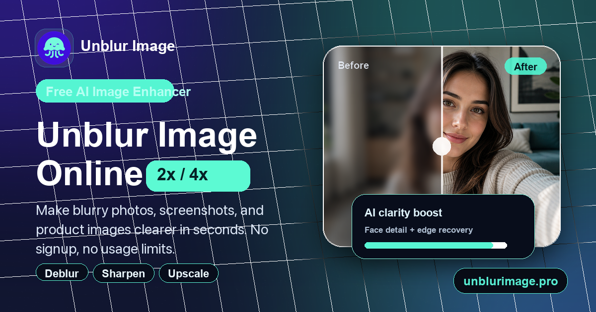
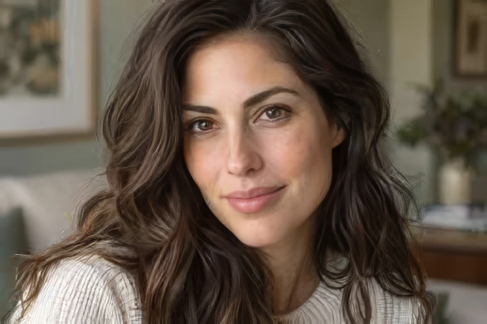
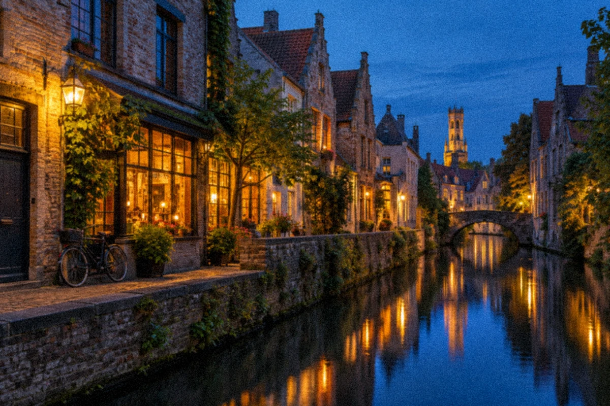
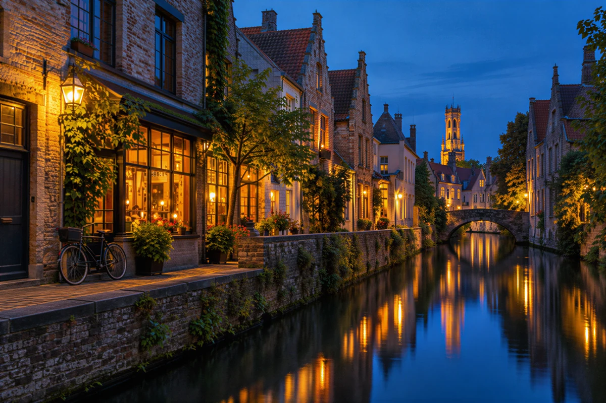

  

  <h1>Unblur Image</h1>

  
<strong>Make blurry photos clearer. Sharpen portraits, upscale images, and reduce noise with AI.</strong>

  

    <a href="https://unblurimage.pro/"><strong>Unblur an Image →</strong></a>
    ·
    <a href="https://unblurimage.pro/ai-image-denoiser">AI Image Denoiser</a>
    ·
    <a href="https://unblurimage.pro/pricing">Plans & Credits</a>
  

  
Free HD available · No sign-up for Free HD · JPG, PNG & WebP · Works in your browser

---

## Give Your Photos a Clearer Second Look

[Unblur Image](https://unblurimage.pro/) is an online AI image enhancer for soft portraits, low-resolution photos, product shots, screenshots, and scanned memories.

Upload an image, choose an enhancement level, compare the original with the result, and download the version you want to keep. Use it to prepare a profile photo, improve a product listing, refresh an old snapshot, or make a visual asset easier to use in your next project.

Start with **Free HD**, which requires no sign-in or credits. For more demanding images, explore the credit-based **Standard**, **High Fidelity**, and **Strong Restore** options.

## See the Difference

### Portrait clarity

<table>
  <tr>
    <th width="50%">Before</th>
    <th width="50%">After</th>
  </tr>
  <tr>
    <td></td>
    <td></td>
  </tr>
</table>

### Low-light detail

<table>
  <tr>
    <th width="50%">Before</th>
    <th width="50%">After</th>
  </tr>
  <tr>
    <td></td>
    <td></td>
  </tr>
</table>

Product demonstration images. The night scene uses an AI-generated source with added blur and noise, processed with Standard enhancement. Results vary by input and enhancement level.

## Core Capabilities

- **AI image unblurring** — improve perceived sharpness in photos affected by soft focus or blur.
- **Portrait enhancement** — bring more definition to faces, hair, and portrait edges.
- **Image upscaling** — enlarge images with 2× / 4× options in Free HD; explore additional output options in the advanced levels.
- **Noise reduction** — clean up grain and improve clarity in low-light photos and other noisy images with the [AI Image Denoiser](https://unblurimage.pro/ai-image-denoiser).
- **Screenshot and document enhancement** — improve edge clarity in soft screenshots and photographed documents.
- **Before-and-after comparison** — inspect the original and enhanced image side by side with an interactive slider on the website.
- **Common image formats** — work with JPG, PNG, and WebP in a browser on desktop or mobile.

## Choose the Enhancement That Fits

| Enhancement level | Best starting point | Access |
| --- | --- | --- |
| **Free HD** | Quick sharpening and 2× / 4× upscaling | Free; no sign-in or credits required |
| **Standard** | Everyday photos and mild blur | Credits; cost varies by resolution |
| **High Fidelity** | Preserving faces, texture, and the original look | Credits; cost varies by resolution |
| **Strong Restore** | More severe blur that needs stronger reconstruction | Credits; may change faces or text |

See the [live tool](https://unblurimage.pro/) for available settings and the [pricing page](https://unblurimage.pro/pricing) for current plans and credits.

## How It Works

1. **Upload your image** — start with a portrait, product photo, screenshot, landscape, or scanned photo in JPG, PNG, or WebP format.
2. **Choose your enhancement** — try Free HD or select an advanced level, then adjust the available output settings.
3. **Compare and download** — review the before-and-after preview and save the result when you are happy with it.

## Made for Images You Already Have

| Your image | What you can improve |
| --- | --- |
| **Product photography** | Clearer product details for marketplace listings and storefronts |
| **Portraits and selfies** | More defined profile pictures and social posts |
| **Old family photos** | Easier-to-view scans and snapshots for sharing |
| **Night and low-light shots** | Less distracting grain and cleaner-looking detail |
| **Creative assets** | Sharper thumbnails, presentation images, and design references |
| **Screenshots and documents** | Clearer edges for review and everyday reuse |

## Frequently Asked Questions

**Can I try it without creating an account?**  
Yes. Free HD works without sign-in or credits. Advanced enhancement levels use credits.

**Do I need to install anything?**  
No desktop editor or browser extension is needed. Open [Unblur Image](https://unblurimage.pro/) and upload a supported image.

**Which option should I choose for grainy photos?**  
Start with the [AI Image Denoiser](https://unblurimage.pro/ai-image-denoiser), then compare the preview to check the balance between cleaner noise and retained texture.

**Can AI recover every detail perfectly?**  
Results depend on the original image. Stronger restoration can reconstruct details and change faces or text, so review the result before using it.

---

  <h2>A Clearer Photo Starts Here</h2>
  
Upload an image, compare the improvement, and give your next project a sharper starting point.

  
<a href="https://unblurimage.pro/"><strong>Try Unblur Image — Start with Free HD →</strong></a>

  
<a href="https://unblurimage.pro/ai-image-denoiser">Explore AI Image Denoiser</a>

This repository is the product showcase for Unblur Image. Use the application at <a href="https://unblurimage.pro/">unblurimage.pro</a>.
